# Awesome Omnichannel Contact Routing 🎧🚀

  

  
  
  
  
  
  
  

---

## 🌐 Top Omnichannel Contact Routing Tools & CCaaS Ecosystem

> **A curated collection of enterprise SaaS platforms and battle-tested open-source GitHub projects focused on Intelligent Work Distribution, Skill-Based Routing, Automatic Call Distribution (ACD), Queue Prioritization, and Unified Contact Center Orchestration.**

**Keywords / SEO**: *Omnichannel Routing, Contact Center as a Service (CCaaS), Skill-Based Routing (SBR), Automatic Call Distribution (ACD), Customer Experience (CX), Interactive Voice Response (IVR), Workforce Management (WFM), Open Source Helpdesk, SIP Telephony Gateway, Intelligent Work Distribution, Service Cloud Routing.*

This repository tracks notable **SaaS platforms** and **open-source frameworks** for **Omnichannel Contact Routing**. These platforms intelligently distribute customer interactions — voice, email, chat, SMS, social channels, and messaging — to the best-equipped agents and AI assistants based on skills, availability, SLAs, priority, and real-time workload metrics.

---

## 📑 Table of Contents
- [📊 Sector Overview & Market Dynamics](#-sector-overview--market-dynamics)
- [🏢 SaaS/Hosted Platforms](#-saashosted-platforms)
- [💻 Open-Source GitHub Projects](#-open-source-github-projects)
  - [🏆 Core Engagement & Helpdesk Suites](#-core-engagement--helpdesk-suites)
  - [☎️ Voice, Telephony & SIP Infrastructure](#️-voice-telephony--sip-infrastructure)
  - [🤖 Conversational AI, Chatbots & Multi-Channel Dispatch](#-conversational-ai-chatbots--multi-channel-dispatch)
  - [⚙️ Workflow Orchestration & Durable Routing Engines](#️-workflow-orchestration--durable-routing-engines)
- [🛠️ Building a Self-Hosted Omnichannel Stack](#️-building-a-self-hosted-omnichannel-stack)
- [🤝 How to Contribute](#-how-to-contribute)
- [📈 Star History](#-star-history)
- [💖 Support & Sponsorship](#-support--sponsorship)
- [⚖️ Disclaimer](#️-disclaimer)

---

## 📊 Sector Overview & Market Dynamics

The global Contact Center as a Service (CCaaS) market is estimated at approximately **$8.0B – $9.5B in 2026** (with the broader contact center software market exceeding **$50B+**), expanding at an annualized CAGR of ~17–19%.

The market exhibits **moderate concentration** among top-tier hyperscalers and legacy enterprise suites — where market leaders such as Amazon Web Services (Amazon Connect), Salesforce, Genesys, NICE, and Five9 capture ~45% of enterprise spend. Concurrently, the sector remains **highly dynamic and fragmented across mid-market, SMB, and specialized verticals** driven by rapid adoption of conversational AI, generative agent-assist, webhook-driven event routing, and open-source data-sovereign telephony stacks.

---

## 🏢 SaaS/Hosted Platforms

*Sorted by company valuation / annual revenue in descending order.*

| 🏷️ Platform | 💼 Company Scale (Valuation / Revenue) | 💵 Starting Tier Pricing | 🎁 Free Tier / Trial Limits | 📝 Description |
| :--- | :--- | :--- | :--- | :--- |
| **[AWS Amazon Connect](https://aws.amazon.com/connect/)** | ~$2.1T+ Market Cap (Amazon) / $100B+ AWS ARR | $0.018/min (voice) & $0.004/msg (chat) | AWS Free Plan: up to 6 months ($100 credits); Customer Profiles free for standard data | Cloud contact center service with skills-based routing, real-time metrics, and pay-as-you-go pricing. |
| **[Salesforce Omni-Channel Routing](https://www.salesforce.com/service/omni-channel/)** | ~$188B+ Market Cap / $37.9B ARR | $25/user/month (Starter Suite) | 30-day free trial with pre-loaded sample data and full Service Cloud workflows | Unified routing engine within Service Cloud that distributes work across channels based on agent capacity, skills, and priority. |
| **[Twilio TaskRouter](https://www.twilio.com/taskrouter)** | ~$42B+ Market Cap / $5.0B ARR | $0.06 per task (or Twilio Flex from $1/active user-hour) | Free forever: First 100 tasks/month free; plus standard $15 trial credits on signup | Programmable routing engine that assigns tasks to workers based on skills, availability, and custom workflows. |
| **[Genesys Cloud CX](https://www.genesys.com/genesys-cloud)** | ~$15B Valuation / $2.6B ARR | $75/user/month (CX 1 - Voice, billed annually) | 30-day GCXNow free trial (capped at 10-min calls, limited test users & messages) | Enterprise contact center platform with predictive routing, omnichannel queuing, and AI-driven agent matching. |
| **[Zendesk Omnichannel Routing](https://www.zendesk.com/)** | ~$10.2B Acquisition Valuation / $2.0B ARR | $55/agent/month (Suite Team, billed annually) | 14-day free trial with full Zendesk Suite Professional access (no agent cap, extendable) | Customer service suite with omnichannel ticket routing, skills-based assignment, and intelligent triage. |
| **[Talkdesk Omnichannel](https://www.talkdesk.com/)** | ~$10.0B Valuation / ~$350M–$420M ARR | $85/user/month (Digital Essentials, 3-yr commitment) | 15-day free trial (Talkdesk Express: up to 10 users, $100 calling credits) | Cloud contact center platform with omnichannel routing, AI-powered agent assist, and real-time queue analytics. |
| **[NICE CXone](https://www.nice.com/cxone)** | ~$6.9B Market Cap / $2.9B ARR | ~$110/agent/month (Digital/Voice Suites entry tier) | No self-serve trial; custom POC/demo provisioned upon sales qualification | Cloud contact center suite with intelligent omnichannel routing, skills-based assignment, and workforce optimization. |
| **[Freshdesk Omnichannel](https://www.freshworks.com/freshdesk/)** | ~$3.6B Market Cap / $839M ARR | $29/agent/month (Growth Omnichannel, billed annually) | 14-day full feature trial; separate Free Program for up to 2 agents (6-month limit) | Support platform with omnichannel routing across email, chat, phone, and social with automation rules. |
| **[Five9 Intelligent Routing](https://www.five9.com/)** | ~$2.6B Market Cap / $1.1B ARR | $119/user/month (Digital tier, 50-seat minimum) | No self-serve trial; proof-of-concept and guided sandbox available via sales | AI-driven routing engine for voice, chat, email, and social channels with predictive engagement and skills matching. |
| **[8x8 Contact Center](https://www.8x8.com/)** | ~$300M Market Cap / $715M ARR | ~$60–$85/user/month (X6 Voice CC tier estimate) | 30-day free trial for 8x8 Express/UCaaS; CCaaS evaluated via customized sales demo | Unified communications and contact center platform with omnichannel routing and real-time queue management. |

---

## 💻 Open-Source GitHub Projects

*Every project includes real-time social badges linking directly to its stargazers page. Sorted by GitHub_Stars in descending order.*

### 🏆 Core Engagement & Helpdesk Suites

- **[Chatwoot](https://github.com/chatwoot/chatwoot)**   
  Open-source omnichannel customer engagement platform with auto-assignment, team inboxes, conversation routing rules, and live chat widgets. Self-hosted alternative to Intercom and Zendesk.
- **[UVdesk](https://github.com/uvdesk/community-skeleton)**   
  Modular enterprise helpdesk system built on Symfony with automated ticket routing, agent workload assignment, and multi-channel intake workflows.
- **[Zammad](https://github.com/zammad/zammad)**   
  Feature-rich open-source helpdesk and ticketing platform with omnichannel queues, skill-based assignment, auto-tagging, and strict SLA management.
- **[FreeScout](https://github.com/freescout-helpdesk/freescout)**   
  Lightweight PHP/Laravel help desk and shared inbox with auto-assignment modules, push notifications, and multi-mailbox routing. Alternative to Help Scout.
- **[osTicket](https://github.com/osTicket/osTicket)**   
  Battle-tested open-source ticketing system supporting custom routing rules, department ticket queues, ticket locking, and SLA escalation filters.
- **[Helpy](https://github.com/helpyio/helpy)**   
  Mobile-friendly Ruby on Rails customer support helpdesk featuring multi-channel email integration, agent triage routing, and knowledge base workflows.

---

### ☎️ Voice, Telephony & SIP Infrastructure

- **[LiveKit](https://github.com/livekit/livekit)**   
  End-to-end WebRTC stack and media server for ultra-low latency audio/video routing, agent rooms, and real-time AI voice assistant dispatch.
- **[FreeSWITCH](https://github.com/signalwire/freeswitch)**   
  Carrier-grade open-source software-defined telecom platform supporting complex ACD queuing, IVR routing engines, WebRTC gatewaying, and multi-tenant voice routing.
- **[Jitsi Meet](https://github.com/jitsi/jitsi)**   
  Open-source video conferencing server suite with SIP gateway bridges (`jibri`/`jigasi`) for interactive video agent queues and routing.
- **[Asterisk](https://github.com/asterisk/asterisk)**   
  The foundational open-source PBX and telephony toolkit with skills-based call routing, dynamic queues (`app_queue`), IVR, and dialplan orchestration.
- **[Kamailio](https://github.com/kamailio/kamailio)**   
  High-throughput SIP proxy server capable of handling millions of call setups daily with dynamic load balancing, failover routing, and carrier interconnect.
- **[OpenSIPS](https://github.com/OpenSIPS/opensips)**   
  Multi-functional SIP implementation providing intelligent call routing, load balancing, dispatcher modules, and high-availability telephony clusters.
- **[FusionPBX](https://github.com/fusionpbx/fusionpbx)**   
  Robust multi-tenant GUI and call routing controller built on top of FreeSWITCH with ring groups, tiered call centers, and IVR menu builders.
- **[ViciDial](https://github.com/vicidial/vicidial)**   
  Enterprise open-source call center suite with inbound ACD routing, blending, outbound predictive dialers, and real-time agent queue monitoring.

---

### 🤖 Conversational AI, Chatbots & Multi-Channel Dispatch

- **[LibreChat](https://github.com/danny-avila/LibreChat)**   
  Open-source multi-agent AI interface featuring custom model routing, preset management, multimodal intake, and secure multi-channel distribution.
- **[Novu](https://github.com/novuhq/novu)**   
  Open-source notification and message delivery infrastructure that dispatches and routes communications across Email, SMS, In-App, Chat, and Push.
- **[Mattermost](https://github.com/mattermost/mattermost)**   
  Secure open-source collaboration platform with webhooks, bots, and incident routing channels for BPO and contact center escalations.
- **[Rasa](https://github.com/RasaHQ/rasa)**   
  Conversational AI framework with intent classification and dialogue management for automated triage and seamless escalation to human agents.
- **[Botpress](https://github.com/botpress/botpress)**   
  Next-generation chatbot builder with human-in-the-loop escalation, omnichannel connectors (WhatsApp, Telegram, Slack), and flow routing.
- **[Synapse (Matrix.org)](https://github.com/matrix-org/synapse)**   
  Reference home server for the Matrix protocol enabling federated, end-to-end encrypted messaging bridges and cross-platform communication routing.
- **[Typebot](https://github.com/baptisteArno/typebot.io)**   
  Visual conversational form builder with branching logic, webhook integrations, and lead handoff routing to CRM and contact agents.
- **[Tiledesk](https://github.com/Tiledesk/tiledesk)**   
  Open-source conversational platform combining no-code chatbot building with omnichannel live chat routing and human agent handoff.

---

### ⚙️ Workflow Orchestration & Durable Routing Engines

- **[n8n](https://github.com/n8n-io/n8n)**   
  Fair-code workflow automation tool with extensive branching nodes for multi-channel intake, webhook event distribution, and CRM sync.
- **[Apache Airflow](https://github.com/apache/airflow)**   
  Distributed orchestration platform for scheduling batch contact triage, SLA escalation workflows, and analytics ETL pipelines.
- **[Keycloak](https://github.com/keycloak/keycloak)**   
  Identity and access management providing single sign-on (SSO), agent role verification, and permission routing across contact center services.
- **[Node-RED](https://github.com/node-red/node-red)**   
  Low-code event-driven programming tool ideal for wiring together hardware telephony gateways, webhooks, and routing dashboards.
- **[Temporal](https://github.com/temporalio/temporal)**   
  Durable execution engine that ensures mission-critical routing decisions, timeouts, retries, and agent availability state machines never drop a task.
- **[Apache Camel](https://github.com/apache/camel)**   
  Comprehensive enterprise integration framework implementing Enterprise Integration Patterns (EIP) for intelligent message and task routing.

---

## 🛠️ Building a Self-Hosted Omnichannel Stack

Developers building data-sovereign contact routing systems often compose these open-source tools:
1. **Frontend / Agent Console**: [Chatwoot](https://github.com/chatwoot/chatwoot) or [Zammad](https://github.com/zammad/zammad) for unified omnichannel inboxes.
2. **Telephony & Media Engine**: [FreeSWITCH](https://github.com/signalwire/freeswitch) or [Asterisk](https://github.com/asterisk/asterisk) alongside [LiveKit](https://github.com/livekit/livekit) for WebRTC audio/video.
3. **Conversational AI & Triage**: [Rasa](https://github.com/RasaHQ/rasa) or [Botpress](https://github.com/botpress/botpress) for intent recognition and self-service deflection.
4. **Resilient Routing Logic**: [Temporal](https://github.com/temporalio/temporal) or [n8n](https://github.com/n8n-io/n8n) for durable queue state and webhook escalations.
5. **Observability**: Prometheus + Grafana for real-time queue latency, agent occupancy, and SLA monitoring.

---

## 🤝 How to Contribute

Contributions are warmly welcomed! To suggest a new tool or update an entry:

1. 🍴 Fork the repository.
2. 🌿 Create a descriptive feature branch (`git checkout -b add-tool-name`).
3. 📝 Update `README.md` maintaining the table format, accurate pricing/trial metrics, and alphabetical/starred order.
4. 🚀 Submit a Pull Request with a brief explanation and links to official documentation.

⭐ **Found this helpful?** Star the repository to support continued maintenance and discovery!

---

## 📈 Star History

---

## 💖 Support & Sponsorship

Thank you for exploring this curated guide to omnichannel contact routing! Maintaining and keeping pricing data, trial limits, and open-source project metrics accurate takes time and care.

If you find this repository valuable:
- ⭐ **Star** this repository and share it with your network!
- 🍴 **Fork** it to build your own custom routing stacks.
- ☕ **Support the maintainer**: You can buy me a coffee and support open-source research via the **[GitHub Sponsors Dashboard](https://github.com/sponsors/ishandutta2007)**.

Your support is deeply appreciated! 🙌

---

## ⚖️ Disclaimer

- This is a community-curated directory intended for research, architectural planning, and educational purposes.
- Contact routing platforms handling telephony, SMS, and payments must comply with applicable telecommunications laws, TCPA, GDPR, HIPAA, and PCI-DSS requirements.
- Self-hosted open-source deployments require independent security hardening and infrastructure high-availability testing.

---

  <b>Built for contact center architects, customer experience engineers, and developers building the future of customer communication.</b> 
  Contributions and updates are always welcome!

